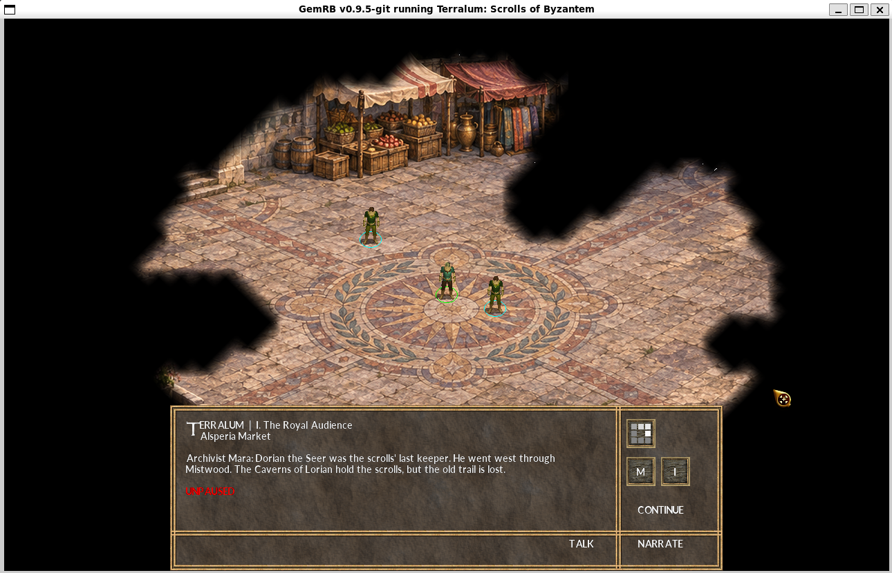

# GemRB

## Introduction

[GemRB](https://gemrb.org) (Game Engine Made with preRendered Background) is a portable open-source
reimplementation of the Infinity Engine that underpinned Baldur's Gate,
Icewind Dale and Planescape: Torment. It sports a cleaner design, greater
extensibility and several innovations.
Would you like to create a game like Baldur's Gate?

To try it out you either need some of the ORIGINAL game's data or you can
get a tiny sneak peek by running the included trivial game demo.

The original game data has to be installed if you want to see anything but
the included trivial demo. On non-windows systems either copy it over from
a windows install, use a compatible installer, WINE or extract it manually
from the CDs using the unshield tool.

Documentation can be found on the [website](https://gemrb.org/Documentation),
in `gemrb/docs/` and the [gemrb.6 man page](https://gemrb.org/Manpage.html).

If you want to help out, start by reading this
list of [options, tips and priorities](https://github.com/gemrb/gemrb/blob/master/CONTRIBUTING.md).

## Terralum: Scrolls of Byzantem

An original fantasy campaign is taking shape inside this GemRB fork. **Terralum: Scrolls of Byzantem** follows Algoreth Jon Goren from the court of Alsperia into a search for the lost scrolls, through the Mistwood and Caverns of Lorian, and onward toward the mysteries of the Tears. Its current prototype spans sixteen scene areas across a seven-act story spine, with a named cast, branching choices, a persistent quest journal, Kokoro narration, ambient music, and gated encounters.

  

<em>Location concept art — visual targets, not in-game screenshots</em>

### Running in GemRB

These captures show the opening Alsperia Market scene running in GemRB. The wide view includes the player, three local NPCs, the current story beat, and Talk, Narrate, and Continue controls. The second capture is a closer look at the scene cast.

  

<em>Alsperia Market — live GemRB capture</em>

  

<em>Market cast — closer view</em>

### Scene art

Fifteen distinct generated concept backdrops preview the sixteen scene areas; one backdrop is reused. They are visual targets for the current prototype. The Hunter's Camp, Three-Cairn Fork, and Mistwood Road have custom searchmaps; the Mistwood stalker spawns on the authored road path. All sixteen areas still use the demo's shared WED layout and other terrain resources.

<table>
  <tr>
    <td align="center"> Alsperia Market</td>
    <td align="center"> Royal Court</td>
    <td align="center"> Mistwood Road</td>
    <td align="center"> Mistwood Watchpost</td>
  </tr>
  <tr>
    <td align="center"> Caverns of Lorian</td>
    <td align="center"> Seal Gallery</td>
    <td align="center"> Council Chamber</td>
    <td align="center"> Academy Courtyard</td>
  </tr>
  <tr>
    <td align="center"> Tear Vault</td>
    <td align="center"> Deep Archives</td>
    <td align="center"> Index Hall</td>
    <td align="center"> Alsperia Skyport</td>
  </tr>
  <tr>
    <td align="center"> Aethercraft Hangar</td>
    <td align="center"> Mistwood Hunter's Camp</td>
    <td align="center"> Three-Cairn Fork</td>
    <td align="center">Sixteen scene areas across seven acts; one backdrop is reused.</td>
  </tr>
</table>

### Explore the project

- [Terralum project guide](terralum/README.md) — build, play, audio, and MCP authoring setup.
- [Gold Standard design pipeline](terralum/GOLD_STANDARD_GAME_DESIGN_PIPELINE.md) — BG2-informed scene and content workflow.
- [Campaign plan](terralum/campaign_plan.md) — seven-act story spine and planned expansion.
- [TODO and handoff](TODO.md) — completed, ongoing, and next work.

Terralum is an in-progress prototype, not a finished or full-length RPG. The current cast reuses demo sprites and all sixteen areas still inherit the demo WED layout; Hunter's Camp, the Three-Cairn Fork, and Mistwood Road have custom searchmaps, while the other thirteen use the generic one. Choices use a custom panel rather than native Infinity Engine DLG resources. The project guide and handoff describe current playability and verification gaps.

## Supported platforms

Architectures and platforms that successfully run or ran GemRB:
* Linux x86, x86-64, ppc, mips (s390x builds, but no running info)
* FreeBSD, OpenBSD, NetBSD
* MS Windows
* various Macintosh systems (even pre x86)
* some smart phones (Symbian, Android, other Linux-based, iOS)
* some consoles (OpenPandora, Dingoo)
* some exotic OSes (ReactOS, SyllableOS, Haiku, AmigaOS, AmberElec, ArkOS, UnofficialOS)

If you have something to add to the list or if an entry doesn't work any more, do let us know!

## Requirements

See the INSTALL [file](https://github.com/gemrb/gemrb/blob/master/INSTALL).

## Contacts

There are several ways you can get in touch:
* [Homepage](https://gemrb.org)
* [GemRB forum](https://www.gibberlings3.net/forums/forum/91-gemrb/)
* [IRC channel](https://web.libera.chat/#GemRB), #GemRB on the Libera.Chat IRC network
* [Discord channel](https://discord.gg/64rEVAk) (Gibberlings3 server)
* [Bug tracker](https://github.com/gemrb/gemrb/issues/new/choose)

## Useful links

Original engine research and data manipulation software:
* [IESDP](https://gibberlings3.github.io/iesdp/), documentation for the Infinity Engine file formats and more
* [Near Infinity](https://github.com/NearInfinityBrowser/NearInfinity/wiki), Java viewer and editor for data files
* [DLTCEP](https://www.gibberlings3.net/forums/forum/137-dltcep/), MS Windows viewer and editor for data files
* [iesh](https://github.com/gemrb/iesh), IE python library and shell (for exploring data files)

Tools that can help with data installation:
* [WINE](https://www.winehq.org), Open Source implementation of the Windows API, useful for installing the games
* [Unshield](http://synce.sourceforge.net/synce/unshield.php), extractor for .CAB files created by InstallShield
